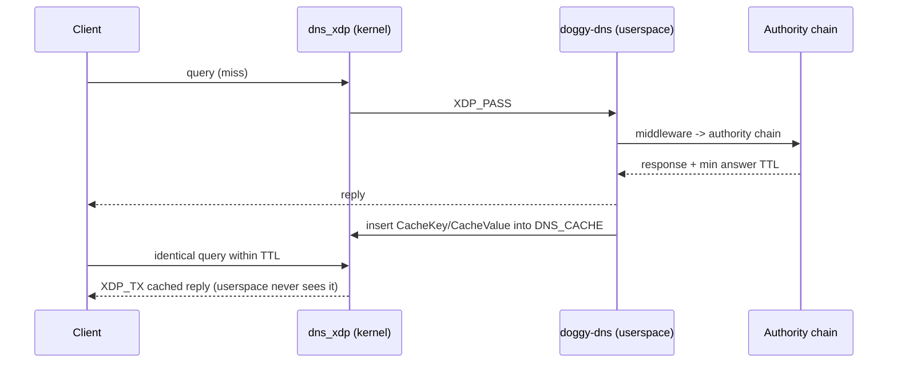

# XDP Kernel Fast Path

Doggy-DNS can answer repeated DNS queries **without leaving kernel space**:
an eBPF XDP program attached to a network interface serves cached replies
directly, and only cache misses fall through to the userspace server. Built
with [aya](https://github.com/aya-rs/aya).

Part of [README](../README.md); see also
[configuration.md](configuration.md) and
[architecture.md](architecture.md).

## Requirements

- Linux (the fast path is a no-op stub on other platforms).
- `bpf-linker` on `PATH` plus the nightly toolchain pinned by
  `xdp/rust-toolchain.toml`. `crates/doggy-dns-xdp/build.rs` compiles the eBPF
  program when the binary is built with `--features xdp`; if the build
  environment cannot compile it, a zero-byte placeholder is embedded and loading
  fails at startup with a warning.
- Root (or `CAP_BPF` + `CAP_NET_ADMIN`) to load and attach the program, and a
  bpffs mounted (usually `/sys/fs/bpf`) for the pinned cache map.

## Build & run

```bash
# 1. Build the binary with the fast path (the eBPF program is compiled by build.rs)
cargo build --release --features xdp

# 2. Enable it in the config (see the [xdp] block in docs/configuration.md)
#    [xdp]
#    enabled = true

# 3. Run as root; the interface comes from config / XDP_INTERFACE / auto-detect
sudo RUST_LOG=info ./target/release/doggy-dns config/doggy-dns.toml

# Verify attachment
ip -d link show <iface>        # xdp program appears under "prog"
```

The first query for a name goes through the normal middleware → authority
pipeline and is written into the BPF map on the way out; identical queries within
the TTL are answered by the kernel. The sequence diagram below shows both paths.

## `[xdp]` configuration

| Key | Default | Meaning |
|-----|---------|---------|
| `enabled` | `false` | Master switch; a failed init degrades to running without the fast path. |
| `interface` | `""` | Resolve order: config value → `XDP_INTERFACE` env → default route parsed from `/proc/net/route`. |
| `cache_size` | `65536` | Maximum entries in the kernel cache. Applied when the map is created at load time (`EbpfLoader::map_max_entries`); the eBPF program only declares the default size. |
| `negative_ttl` | `30` | Seconds a cached NXDOMAIN is served. Also the fallback TTL when a positive answer exposes none. |
| `attach_mode` | `"auto"` | `auto`: attach to the interface at startup. `manual`: load only, leaving attachment to an external tool. |
| `pin_path` | `/sys/fs/bpf/doggy-dns/dns_cache` | Where the cache map is pinned so it survives (and can be re-attached across) restarts. |

## How it works

### Runtime architecture

```
        +======================================================================+
        | INGRESS on <iface>   (XDP_DEFAULT hook; UDP traffic only)            |
        |                                                                      |
        |   1  eth / IPv4 / UDP?                     no -> XDP_PASS            |
        |   2  dport == XDP_CONFIG.dns_port?         no -> XDP_PASS            |
        |   3  QR=0 and QDCOUNT=1?                   no -> XDP_PASS            |
        |   4  FNV-1a key over qname + qtype + qclass                          |
        |   5  DNS_CACHE.get(key)      miss/expired -> XDP_PASS (counted)      |
        |   6  bpf_xdp_adjust_tail, then:                                      |
        |         positive hit : copy cached reply (<= 512 B), patch TXID      |
        |         negative hit : synthesise the NXDOMAIN header                |
        |         pre-resize failure  -> XDP_PASS                              |
        |         post-resize failure -> XDP_DROP (query already rewritten)    |
        |   7  swap MAC/IP/ports, fix lengths, RFC1624 incremental checksum    |
        |   8  XDP_TX  (no context switch; userspace never sees the query)     |
        +======================================================================+
             BPF maps     DNS_CACHE  LruHashMap, 65536 entries
                         XDP_CONFIG Array[1] {dns_port}, written pre-attach
                         XDP_STATS  PerCpuArray {hit, negative_hit, miss,
                                                  expired, drop}
               kernel reads ^   userspace writes (map pinned at pin_path)
                             |
      miss -> stack -> socket|       ^ hit -> XDP_TX straight to the client
                             v       |
    +======================================================================+
    | USERSPACE doggy-dns (cargo feature "xdp")                            |
    |                                                                      |
    |   UDP :port -> middleware chain -> AuthorityChain                    |
    |                                   (nacos / native / forward)         |
    |   XdpCacheMiddleware.after_request -> DNS_CACHE.insert               |
    |       NoError entry : min answer TTL                                 |
    |       NXDomain entry: negative_ttl                                   |
    |   observability: XDP_STATS poller -> OTLP dns.xdp.queries{result=..} |
    +======================================================================+
```

### First query vs cached query



### Kernel side (`xdp/doggy-dns-xdp-ebpf`)

The numbered path in the runtime diagram above is the whole program: anything it
does not recognise is `XDP_PASS`ed to the network stack untouched. Details the
diagram leaves out:

- The cache key is FNV-1a over the QNAME's raw wire bytes (length prefixes
  included, lowercased) plus `qtype`/`qclass`; the userspace key builder
  produces the identical hash.
- Freshness uses `expires_at` against `bpf_ktime_get_ns`, the same monotonic
  clock userspace timestamps with.
- Positive replies are copied chunked and bounds-checked, capped at 512 bytes,
  with the transaction ID overwritten by the current query's.
- Header rewrite swaps MACs/IPs/ports, fixes IP total length and UDP length, and
  updates the IPv4 checksum incrementally (RFC 1624).
- After `bpf_xdp_adjust_tail` the original query no longer exists, so any later
  failure drops the packet rather than passing a truncated frame upward.

### Userspace side (`crates/doggy-dns-xdp` + `src/xdp/`)

- **`XdpManager`** loads the embedded ELF, takes and pins `DNS_CACHE`, wraps
  `XDP_STATS`, writes `XDP_CONFIG { dns_port }`, then loads the program and
  (in `auto` mode) attaches it to the interface. The manager must stay alive
  for the server lifetime — dropping it detaches the program.
- **`XdpCacheMiddleware`** is appended to the middleware chain on success. In
  `after_request` it caches only `NoError` and `NXDomain` responses that carry
  the serialized reply: positive entries expire at the minimum TTL across the
  answer records, negative entries at `negative_ttl`. Expiry uses
  `CLOCK_MONOTONIC` so userspace timestamps share the kernel's `bpf_ktime_get_ns`
  clock. A cache write failure is logged and the request still succeeds.
- **Stats**: the program counts `hit` / `negative_hit` / `miss` / `expired` /
  `drop` in a per-CPU array. A poller snapshots the map every
  `observability.metrics.interval_secs`, converts snapshots to deltas
  (reload-safe: counters that went backwards are treated as a fresh map), and
  exports them as the OTLP metric `dns.xdp.queries`, labelled by result. If
  OTLP metrics are disabled the counters are collected but not exported (a
  warning says so at startup).

## Limitations & notes

- **UDP only** — XDP sees inbound UDP queries; TCP/DoT/DoH always go through
  userspace.
- **One XDP program per interface** in default mode — a second attach fails
  with `EBUSY`.
- **Cache admission is limited to 512-byte replies** — the response is
  serialized with the client's EDNS payload size, then cached only if the
  actual wire length is ≤512 bytes and the reply is not truncated. EDNS
  queries with small answers are cached; larger or truncated answers are
  served from userspace and never cached.
- **Keyed by 64-bit FNV-1a hash, not the name itself** — a collision would
  serve another name's answer. Acceptable for a private resolver cache, worth
  knowing before exposing it publicly.
- **`cache_size` is fixed once the map is created** — it is applied at load
  time, not resized in place; restart to change it.
- The kernel program has no logging today; silent passes are observable only
  through the `miss` / `expired` / `drop` counters.

## Development

```bash
cargo check --workspace --features xdp          # userspace crate compiles on any OS
cargo test -p doggy-dns-xdp                     # pure logic: key hashing, deltas, config
cargo build -p doggy-dns --features xdp         # full binary incl. eBPF build.rs step
cd xdp && cargo build -Z build-std=core,alloc --release --target bpfel-unknown-none  # eBPF only
sudo -E cargo test -p doggy-dns-xdp --test xdp_integration_test -- --ignored  # load + attach on loopback (Linux, root)
cargo bench -p doggy-dns-xdp                    # component benchmarks
```

The BPF struct layout (`CacheKey`, `CacheValue`, `XdpStats`,
`XdpRuntimeConfig`) is intentionally duplicated between
`crates/doggy-dns-xdp/src/types.rs` and
`xdp/doggy-dns-xdp-ebpf/src/types.rs`; `XdpStats` has a drift-guard test, but
the others must be edited in both places together.
